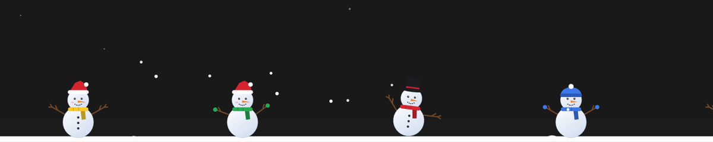
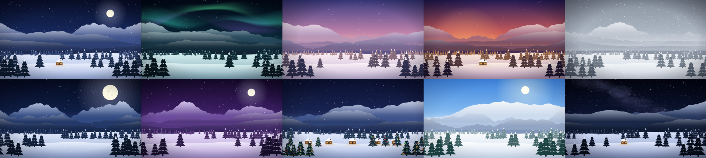

# ❄ desktop-snow

Windows 바탕화면, 열린 창, 작업표시줄 위에 **눈이 내리고 쌓이는** 작은 프로그램입니다.
쌓인 눈을 마우스로 집어 눈덩이를 굴리고, 눈사람을 만들고, 던지고, 제설차를 부를 수 있어요.

Snow that falls and **piles up on your Windows desktop, windows and taskbar** — roll snowballs, build snowmen, throw them, and call a snowplow.


## 기능

- ❄ **모든 창 위에 쌓이는 눈**: 창 윗면과 작업표시줄 위에 눈이 소복이 쌓여요. 다른 창에 가려진 부분에는 쌓이지 않아요.
- 🪟 **창을 움직이거나 닫으면 우수수**: 쌓인 눈이 떨어져서 아래에 다시 쌓여요.
- ⛄ **굴릴수록 커지는 눈덩이**: 쌓인 눈 위에 마우스를 올리면 🧤 장갑 커서로 바뀌어요. 집어서 눈 위에서 굴리면 점점 커져요.
- ☃ **쌓으면 눈사람 완성**: 놓인 눈덩이 위에 다른 눈덩이를 올리면 눈사람이 돼요. 모자, 목도리, 표정이 다른 5종이에요.
- 💃 **살아 있는 눈사람**: 숨 쉬고, 눈 깜빡이고, 가끔 춤을 춰요. 콕 누르면 폴짝 뛰며 손을 흔들어요.
- 💥 **던지면 와장창**: 휙 던지면 화면 벽에 맞고 튕기다가 부서져요.
- 🚜 **제설차 부르기**: 작업표시줄 위의 눈을 싹 밀어 줘요.
- 🖼 **겨울 배경화면 10종**: 프로그램이 직접 그린 겨울 풍경을 바로 바탕화면으로 쓸 수 있어요. 원래 배경화면으로 되돌리기도 지원해요.
- 🔋 **절전**: 노트북이 배터리로 돌아갈 때는 자동으로 저전력 모드로 바뀌어요.
- 🖥 **듀얼 모니터와 고해상도(HiDPI) 화면을 지원해요.** 클릭은 그대로 아래 창으로 통과하니 평소처럼 작업할 수 있어요.



### 겨울 배경화면 10종



## 설치 / 실행

1. [Releases](../../releases)에서 `Snow.exe`를 받아 실행하세요. 설치할 필요가 없어요.
2. "Windows의 PC 보호" 경고가 뜨면 **추가 정보 → 실행**을 누르세요. 코드 서명이 안 된 프로그램이라 뜨는 경고예요.
3. 작업표시줄 오른쪽 트레이의 ❄ 아이콘을 **우클릭**하면 메뉴가 나와요.

**요구 사항:** Windows 10/11. Windows에 기본으로 들어 있는 .NET Framework 4.x 외에는 따로 설치할 게 없어요.

## 트레이 메뉴

| 메뉴 | 설명 |
|---|---|
| 눈 양 | 조금 / 보통 / 많이 / 펑펑 |
| 🚜 제설차 부르기 | 작업표시줄 위 눈 치우기 |
| 마우스로 눈 놀이 | 눈덩이와 눈사람 놀이 켜기/끄기 |
| 눈 쌓이기 | 쌓임 효과 켜기/끄기 |
| 창 위의 눈 털기 / 쌓인 눈 모두 치우기 / 눈덩이·눈사람 모두 부수기 | 정리 |
| 겨울 배경화면 | 10종 중 선택, 원래대로 되돌리기 |
| 절전 | 저전력 모드, 배터리 사용 중 자동 저전력 |
| 일시정지 | 트레이 아이콘을 더블클릭해도 돼요 |
| Windows 시작 시 자동 실행 | 로그인할 때 자동으로 시작 |

## 직접 빌드하기

Visual Studio 없이 Windows에 기본으로 들어 있는 C# 컴파일러로 빌드할 수 있어요.

```bat
C:\Windows\Microsoft.NET\Framework64\v4.0.30319\csc.exe /nologo /target:winexe /out:Snow.exe /r:System.Windows.Forms.dll /r:System.Drawing.dll Snow.cs
```

### 실행 옵션

| 옵션 | 설명 |
|---|---|
| `Snow.exe --demo` | 눈사람 5종을 세우고 제설차를 출발시키는 미리보기 |
| `Snow.exe --lowpower` | 저전력 모드로 시작 |
| `Snow.exe --render-wallpapers <폴더>` | 배경화면 10종을 PNG로 저장 |

## 동작 방식 (개발자용)

- 화면 전체를 덮는 투명한 창(layered window, `UpdateLayeredWindow`)에 GDI+로 그려요. 평소에는 클릭이 통과하는 창(`WS_EX_TRANSPARENT`)이에요.
- 커서가 쌓인 눈, 눈덩이, 눈사람 위에 있을 때만 클릭을 받아요.
- 창 위치와 쌓이는 순서는 `EnumWindows`와 DWM이 알려 주는 실제 창 영역으로 매 프레임 추적해요.
- 단일 소스 파일 `Snow.cs` 하나로 되어 있어요.

## 라이선스

[MIT](LICENSE)
